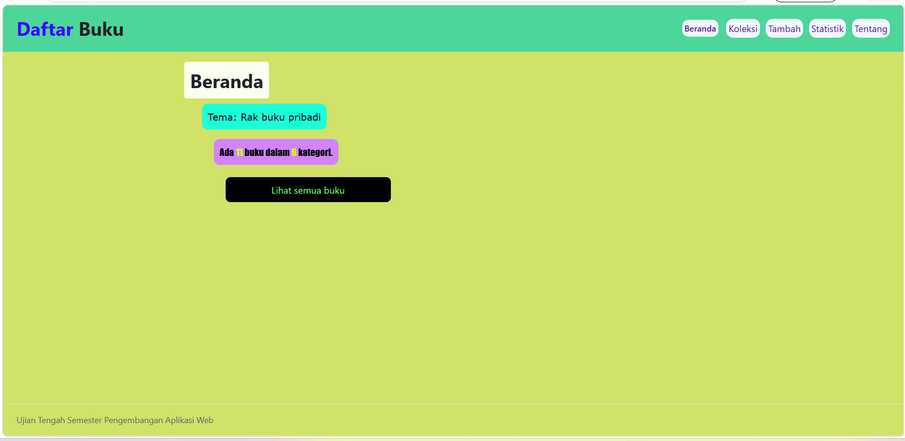
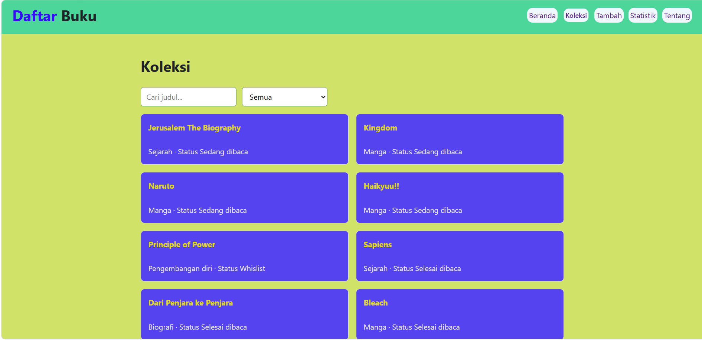
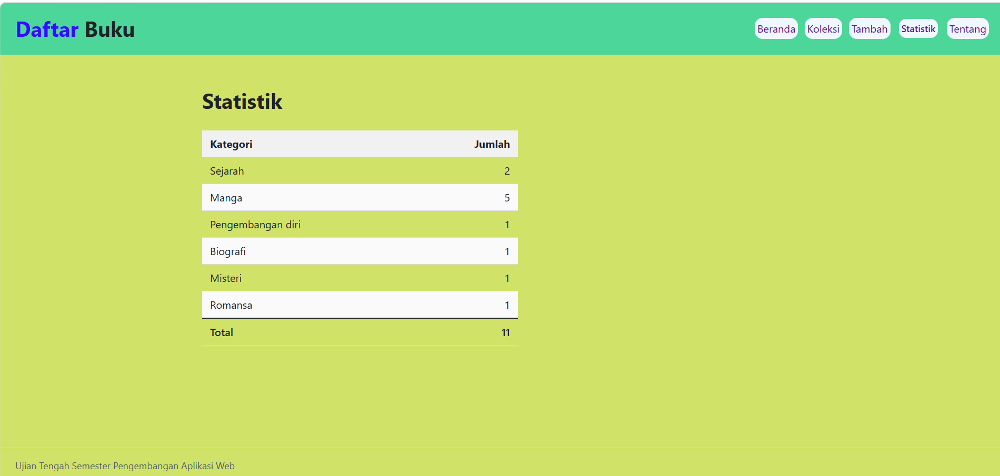
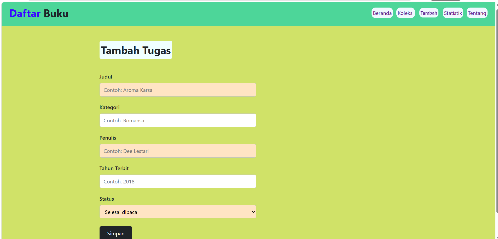
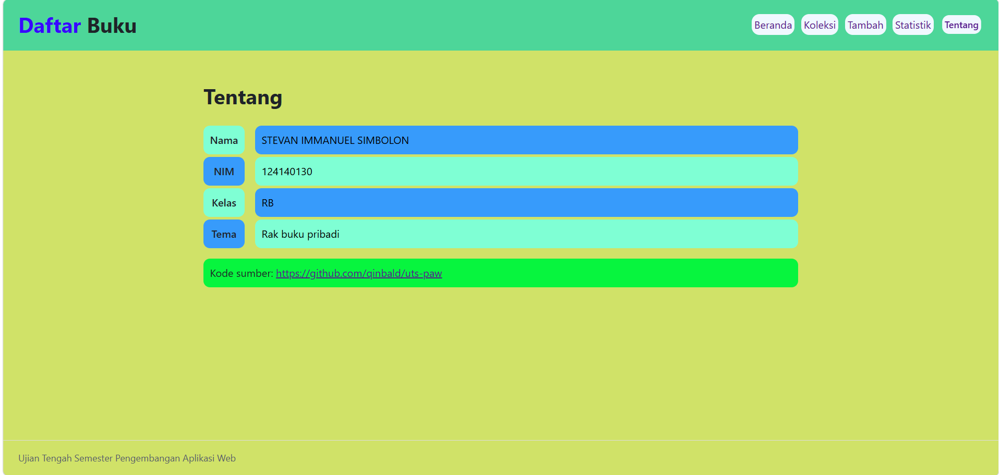
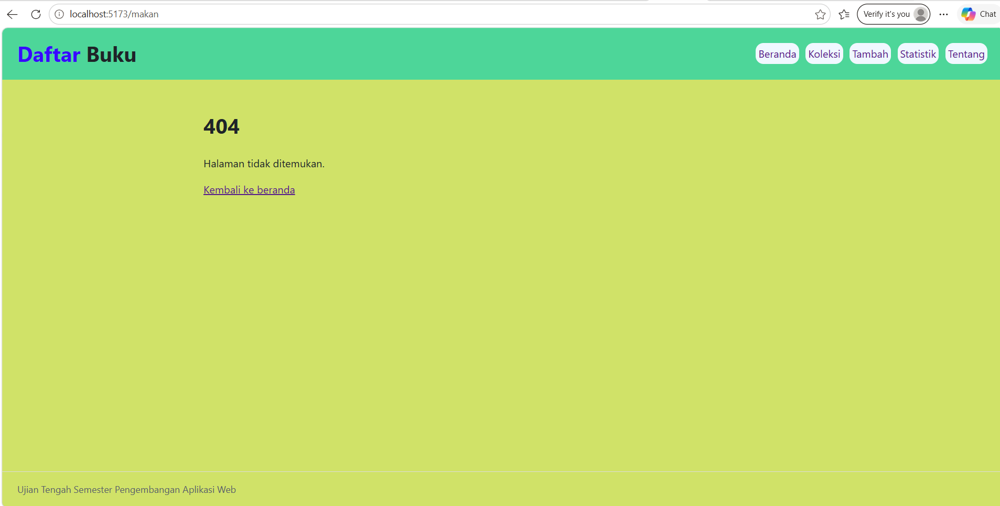

# identitas
| Identitas | Keterangan |
| :--- | :--- |
| **Nama** | Stevan Immanuel Simbolon |
| **NIM** | 124140130 |
| **Kelas** | RB |
| **Tema** | Rak Buku Pribadi |

# Link Deployment 
**Link Deployment** : https://qinbald.github.io/uts-paw/

# Tangkapan Layar

## Fitur

- Dapat melihat daftar bacaan buku
- Dapat menambahkan dan menghapus buku yang dibaca atau mau dibaca
- Dapat mencari buku yang dimasukkan ke daftar
- Dapat menyimpan koleksi buku
- Dapat melakukan pendataan jumlah buku berdasarkan kategori

## Menjalankan secara lokal

1. cd app

2. npm install

3. npm run dev

## Konsep React yang dipakai

### Konsep React yang Digunakan

1. **Komponen Fungsional & JSX**  
   Membangun antarmuka  menjadi komponen-komponen terpisah yang dapat digunakan kembali (`Layout`, `Koleksi`, `KartuItem`, `KotakPencarian`).

2. **useState**  
   Mengelola data dinamis yang memicu *re-render* otomatis saat terjadi interaksi pengguna, seperti menyimpan teks pencarian judul dan filter pilihan kategori.

3. **Aliran Data Melalui Props**  
   Meneruskan data dan fungsi dari komponen induk ke komponen anak (misalnya mengirim data buku ke `KartuItem` atau fungsi pencarian ke `KotakPencarian`).

4. **Perenderan Daftar & Kunci Unik**  
   Melakukan iterasi array data menggunakan fungsi JavaScript `.map()` untuk merender elemen kartu secara dinamis, disertai atribut `key` unik untuk efisiensi pembaruan.

5. **Perutean**  
   Mengatur navigasi multi-halaman tanpa memuat ulang browser menggunakan ekosistem `react-router-dom` (`<Outlet />`, `<Link>`, `<NavLink>`).

